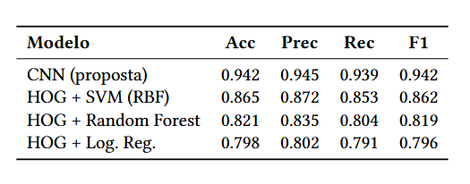
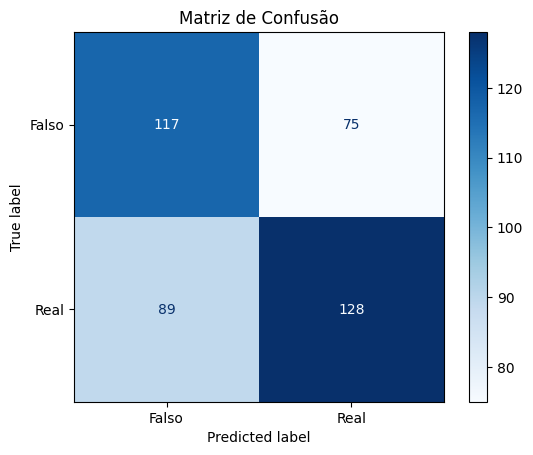

# Detecção de faces falsas

Projeto de iniciação científica em Ciência da Computação na UFSCar. O estudo comparou uma rede neural convolucional (CNN) com três classificadores que usam descritores de gradientes orientados (HOG) para distinguir fotografias reais de rostos e imagens manipuladas.

**Julia Campanelli Granja** · Orientação da **Profa. Dra. Marcela Xavier Ribeiro** · Apoio do **CNPq**

## Resultados do estudo

A CNN alcançou 94,2% de acurácia na comparação apresentada no pôster do CIC. Entre os modelos com HOG, o melhor resultado foi o da SVM com kernel RBF (86,5%).

## Experimento disponível

O [notebook](notebooks/Faces.ipynb) registra uma etapa exploratória com a base do CIPLab. Ele carrega as imagens em RGB, redimensiona para 128 × 128 pixels e reserva 20% para validação, preservando a proporção entre as classes. A CNN treina por dez épocas. As últimas células permitem inspecionar exemplos, visualizar o Grad-CAM da classe real e comparar a distribuição dos scores. O código da comparação final com HOG não está disponível neste repositório.

A matriz abaixo pertence à etapa exploratória. Nesse registro, a CNN classificou corretamente 117 das 192 imagens falsas e 128 das 217 reais (245/409, ou 59,9%). A divisão das imagens e o treinamento têm componentes aleatórios, portanto os resultados podem variar entre execuções.

## Como executar no Google Colab

1. Baixe o arquivo [Faces.ipynb](notebooks/Faces.ipynb). Abra o [Google Colab](https://colab.research.google.com/) e carregue o notebook pela opção de upload.
2. Execute as células em ordem. A primeira instala o cliente de download. A seguinte baixa a base pública [Real and Fake Face Detection, do CIPLab](https://www.kaggle.com/datasets/ciplab/real-and-fake-face-detection) para o ambiente da sessão. Uma GPU é opcional para o treinamento.
3. Se preferir baixar a base manualmente, extraia o ZIP em uma pasta acessível pelo Colab e informe essa pasta em `PASTA_LOCAL` na segunda célula de código. O notebook procura os diretórios `training_real` e `training_fake` dentro dela. O Google Drive é opcional.

O estudo comparativo também utilizou [Human Faces, de ashwingupta3012](https://www.kaggle.com/datasets/ashwingupta3012/human-faces). Para executar o notebook deste repositório, basta a base do CIPLab. As imagens são distribuídas pelos respectivos responsáveis nas páginas das bases.
